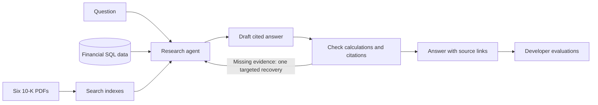
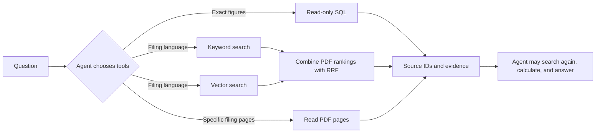

# 10-K research assistant

## What I built

A local interactive chat answers ad hoc financial questions about Apple, Microsoft, and Alphabet. Users can ask follow-ups, choose an answer style, reopen earlier chats, and inspect linked SQL results or PDF pages. The developer workspace shows ingestion, agent steps, and evaluations. **Codex was used as an AI coding assistant** during implementation and report preparation.

## How the system works

The agent makes a short research plan, chooses tools from the question, checks what is missing, and can gather more evidence before answering. It uses SQL for figures, PDF search for narrative, or both for a mixed question. The plan is a checklist, not a fixed route. Independent tool calls can run in parallel while source IDs remain stable.

SQL supplies exact values. Keyword search matches filing terms; vector search finds similar meaning. Reciprocal rank fusion (RRF) combines PDF rankings. PDF chunks retain document and page details. Derived figures use a calculator with evidence-backed operands; directly reported figures can be cited without recalculation. Citation, calculation, and semantic checks reduce errors but cannot prove every claim true.

## Final evaluation: ten saved development answers

The results below all use answer run `run-20261118-204049-9c1abd`, made with DeepSeek V4.1 Flash. The included ten-question evaluation set provides a golden answer and grading method for each question. Benchmark grading uses those methods. These are in-repo questions, not a held-out test.

| Check | Result | What it measures |
| --- | ---: | --- |
| Benchmark Evaluation | **9 correct, 1 partial** | Saved answers versus golden answers, using numeric tolerance, entity-and-number matching, or an LLM judge. |
| RAGAS Faithfulness | **0.988 mean; 10/10 scored** | Whether claims the agent made follow from its SQL/PDF evidence. |
| RAGAS Response Relevancy | **0.878 mean; 10/10 scored** | Whether answers address their questions. |
| RAGAS cited-evidence Context Precision / Recall | **0.981 / 1.000; 10/10 scored** | Final cited sources in first-citation order. |
| RAGAS agent-exposed Context Precision / Recall | **0.872 / 1.000; 10/10 scored** | All SQL/PDF sources exposed by tool calls, including uncited sources. |

Generation Evaluation uses **official RAGAS** Faithfulness and Response Relevancy. GLM-5.3 judges claim support; Nomic embeddings compare questions generated from an answer with the original question. Faithfulness is supported claims divided by all checked claims. A perfect score does not mean the answer covered everything requested.

There were **no human passage labels**. Retrieval Evaluation uses official RAGAS Context Precision and Context Recall, with a Fireworks LLM judging passage usefulness and whether claims in the golden answer are supported. Precision rewards useful sources early; recall is the share of golden-answer claims attributable to those sources. The page shows labels, reasons, calculations, and supporting chunk IDs. These are **LLM estimates**, not human ground truth. Agent exposure order spans multiple searches and is not one global search ranking; cited precision uses citation order rather than retrieval rank.

| Question | Benchmark | Faithfulness | Retrieval finding |
| --- | --- | ---: | --- |
| q_006, supply-chain risks | Correct | **0.875** | Cited P/R **1.000/1.000**; all-exposed P **0.686**. RAGAS rejected the unsupported “five main risks” count and a causal link between single sourcing and other supply constraints. |
| q_017, Google Services | Correct | 1.000 | Cited P **0.806**; all-exposed P **0.698**. Some sources added little to the answer. |
| q_025, Apple Services | **Partial** | 1.000 | Cited P **1.000**; all-exposed P **0.559**; both recall scores **1.000**. Growth figures match, but the answer did not fully cover the golden answer's recurring-revenue and strategic discussion. |

The other seven answers were benchmark-correct and scored 1.000 for cited precision and recall. q_025's cited precision of 1.000 **does not mean every citation was useful**: the useful first citation earned a perfect ranking score even though the judge labeled several later citations irrelevant. Retrieval recall of 1.000 means the *sources* collectively supported the golden-answer claims; it does not mean the *answer* stated them all. q_006 shows another limit: benchmark coverage can pass while Faithfulness flags unsupported wording.

### Answer time

Times include answering and tool use, but exclude later evaluations. **Median: 24.3 s; mean: 23.0 s** across all ten answers.

| Question | Time | Relative time |
| --- | ---: | --- |
| q_001 | **5.6 s** | █ |
| q_006 | 22.9 s | █████ |
| q_025 | **58.5 s** | ████████████ |

The fastest question needed a direct financial figure. The slowest combined several years of numbers, calculations, and filing searches. These are observations from one run; model response time, search count, and verification can all affect latency.

## Trade-offs and what I would improve

**Trade-offs**

- Local SQLite and Qdrant make the demo reproducible and keep the data on the user's machine. Fireworks model calls still require a key, add latency, and incur cost.
- Hybrid PDF search handles both exact phrases and paraphrases. Follow-up searches help with multi-part questions, but may retrieve extra passages that add time and can weaken precision.
- LLM judges make evaluation possible without human passage labels, but their decisions need spot checks.

**With more time**

- Lower answer latency by timing each model and tool step, avoiding redundant searches, and testing smaller evidence sets without losing answer quality.
- Cache stable embeddings, repeated searches, and evaluation inputs where safe. Run independent evaluation questions in parallel with bounded concurrency to reduce evaluation time.
- Improve failure inspection with clearer per-step diagnostics and explicit retry of only the failed answer or metric, while preserving successful results.
- Add an **independent held-out** set with unfamiliar wording, new combinations of facts, and mixed SQL/PDF tasks; have people review a sample of claims and passage labels. The strong scores on just **ten known questions about three companies** do not yet establish generalization.

## RAGAS references

Official metric documentation: [Faithfulness](https://docs.ragas.io/en/stable/concepts/metrics/available_metrics/faithfulness/), [Response Relevancy](https://docs.ragas.io/en/stable/concepts/metrics/available_metrics/answer_relevance/), [Context Precision](https://docs.ragas.io/en/stable/concepts/metrics/available_metrics/context_precision/), and [Context Recall](https://docs.ragas.io/en/stable/concepts/metrics/available_metrics/context_recall/).
